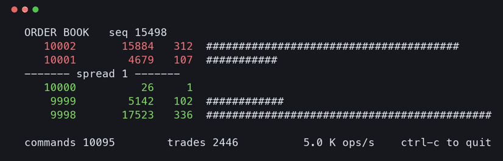
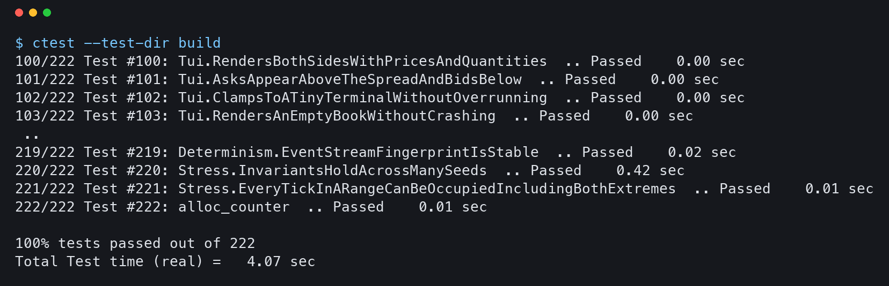
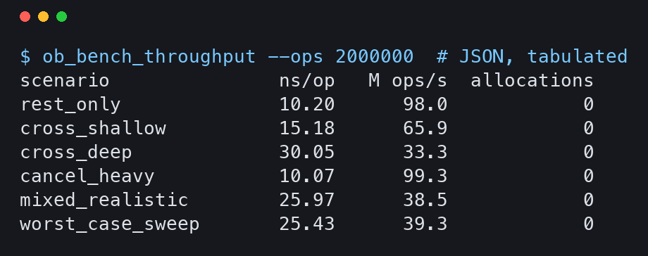
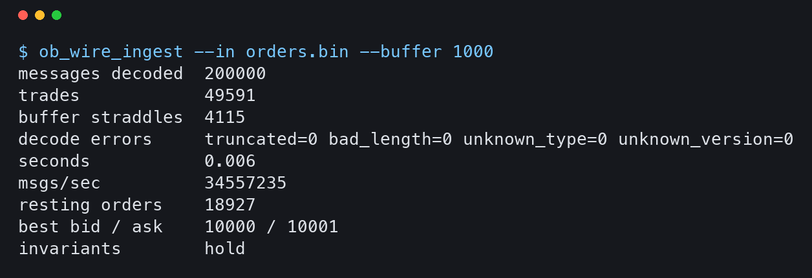
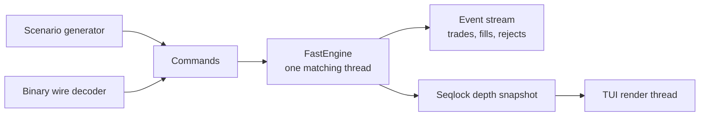
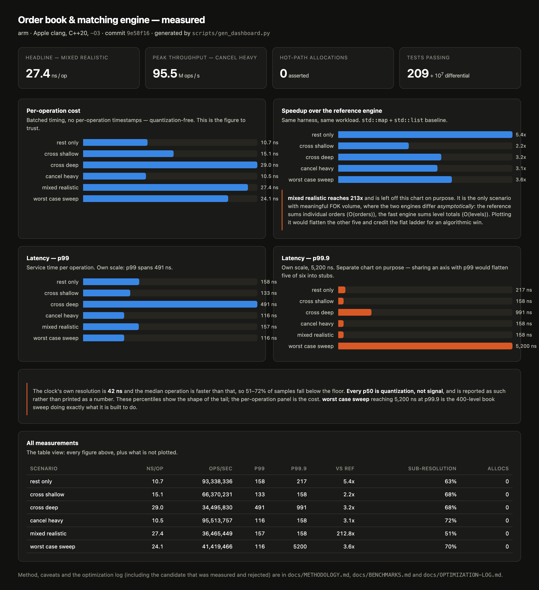

# Order book and matching engine

A limit order book and matching engine in C++20: price-time priority, five order types,
deterministic output and no allocation on the hot path. It comes with the tests and the
measurement harness needed to back up its numbers.

**28.8 ns per operation, 34.8 M ops/s** on the realistic workload · **zero divergence**
from a reference engine over 10,000,000 operations · **222 tests** passing



*The live terminal view, recorded from a real `ob_replay --tui` run. Asks are red, bids are
green, and each row shows price, total quantity and order count.*

| Contents | |
|---|---|
| [Try it in two minutes](#try-it-in-two-minutes) | Build, test and run all four demos |
| [How it works](#how-it-works) | Request flow and data structures |
| [Performance](#performance) | Results, method and caveats |
| [How it is tested](#how-it-is-tested) | Seven layers of verification |
| [Project status](#project-status) | What is built and what is only planned |

## Try it in two minutes

You need CMake, Ninja and a C++20 compiler. GoogleTest is fetched during configure, so the
first run needs network access.

```bash
brew install cmake ninja     # macOS; use your package manager on Linux

git clone https://github.com/dhanush1-2/orderbook-cpp.git
cd orderbook-cpp
cmake -S . -B build -G Ninja -DCMAKE_BUILD_TYPE=Release \
      -DOB_BUILD_BENCH=ON -DOB_BUILD_TOOLS=ON
cmake --build build
```

### 1. Run the tests

```bash
ctest --test-dir build
```



This covers unit tests, the edge-case table against both engines, invariants over random
streams, determinism, the seqlock under contention and the zero-allocation check. (The
screenshot shows a shortened listing.)

### 2. Watch the book live

```bash
./build/tools/ob_replay --scenario mixed_realistic --ops 200000 --rate 5000 --tui
```

Press `ctrl-c` to quit; your terminal is restored on exit.

The order flow is generated, not real market data. The render thread reads a **seqlock**, so
the matching thread publishes a depth snapshot and never waits for a viewer. A test
(`tests/test_publisher_isolation.cpp`) confirms that a reader dying mid-publication cannot
block the writer.

### 3. Measure it

```bash
./build/bench/ob_bench_throughput --ops 2000000
./build/bench/ob_bench_latency    --ops 500000
```



*One run on an Apple M4 Pro, with the JSON output tabulated. Single runs vary; the
[published numbers](#performance) are the median of five.*

### 4. Send orders over the wire format

```bash
./build/tools/ob_wire_gen    --scenario mixed_realistic --ops 200000 --out orders.bin
./build/tools/ob_wire_ingest --in orders.bin --buffer 1000
```



This encodes orders into a binary protocol, then decodes them through a deliberately small
1,000-byte buffer. **4,115 messages straddle a buffer boundary**, and the final book still
matches the in-process run. An automated test checks that equivalence.

## How it works



**Matching rules**

- Order types: `Limit`, `Market`, `Ioc`, `Fok` and `PostOnly`, plus `Cancel`.
- Price-time priority, with trades printing at the **maker's** price.
- Prices and quantities are integers everywhere; no floating point touches them.
- Output is a deterministic, gap-free, sequenced event stream.
- Failures return a typed reason code and leave the book bit-for-bit unchanged.

**Data structures**

| Component | Choice | Why |
|---|---|---|
| Price levels | Flat array of 65,536 ticks | O(1) access to any level, with no tree to chase |
| Best price | Three-level occupancy bitmap | Finds the next occupied level with a few bit scans |
| Orders | 32-byte records in a preallocated pool, linked by index | No allocation on the hot path; O(1) removal from a FIFO |
| ID lookup | Open-addressed hash with blocked hashing and backward-shift deletion | O(1) cancel with no tombstones |

The full reasoning, including the alternatives rejected and 49 enumerated edge cases, is in
the [design document](docs/superpowers/specs/2026-09-22-order-book-matching-engine-design.md).

## Performance

Measured on an Apple M4 Pro (arm64) with Apple clang 21 at `-O3`. Each figure is the median
of 5 separate processes, and a run with over 10% spread is rejected.



| Scenario | ns/op | Throughput | p99 | p99.9 |
|---|---|---|---|---|
| `mixed_realistic` (headline) | **28.8** | **34.8 M ops/s** | 148 ns | 190 ns |
| `cancel_heavy` | 9.8 | 102.5 M ops/s | 107 ns | 149 ns |
| `rest_only` | 7.7 | 129.6 M ops/s | 149 ns | 232 ns |
| `cross_deep` | 25.7 | 39.0 M ops/s | 482 ns | 1,024 ns |
| `worst_case_sweep` | 25.1 | 39.9 M ops/s | 107 ns | 5,440 ns |

**Zero allocations** in every measured window; the run fails if the counter moves.

Read these numbers with the following in mind:

- **The clock can't resolve one operation.** Timestamp granularity is 42 ns and an operation
  takes about 29 ns. So ns/op comes from an untimestamped batched loop, and the percentiles
  show the shape of the tail, not exact values.
- **The honest speedup over the reference engine is 2.7x to 10.8x.** One scenario shows 195x,
  but that comes from a single asymptotic difference in the FOK pre-scan, not the flat ladder.
- **The optimization that landed came from a failure.** Identity hashing was 35-67% faster on
  five scenarios and 281% slower on the sixth. Understanding why led to a blocked hash that is
  faster on all six, -30.3% overall. Both are in the
  [optimization log](docs/OPTIMIZATION-LOG.md).
- **The CI instruction-count gate can't see that win.** The blocked hash runs more instructions
  while taking less time, so the gate reads it as a regression.
- **These are not hardware-counter numbers.** No hardware counters were accessible on this
  machine, in Docker or on GitHub runners. Cache figures are Cachegrind simulations.
- **This is not an isolated, bare-metal setup.** Threads aren't pinned, and it ran on a
  general-purpose machine.

Details: [benchmark results](docs/BENCHMARKS.md) · [methodology](docs/METHODOLOGY.md)

Regenerate the images in this README with:

```bash
./scripts/gen_dashboard.py --png     # dashboard, from benchmark results
./scripts/gen_demo_assets.py         # terminal images, by running the demos (macOS, needs Pillow)
```

## How it is tested

| Layer | Result |
|---|---|
| Unit tests | **222 passing** |
| Edge-case table, run against both engines | **40 cases** covering spec E1-E49 |
| Whole-book invariants after every operation | 100,000 operations across 25 seeds; broken engine doubles prove the checker can fail |
| Random-stream stress, with a failure shrinker | Clean; any failure reduces to a minimal reproducer |
| Determinism across `-O0` and `-O3` | Identical digest `d54a7c38cb35f3e3` over 104,880 events |
| Differential against the reference engine | **10,000,000 operations**, zero divergence |
| Coverage-guided fuzzing | 73,977 engine and 146,576 wire-parser units, zero crashes |

ASan, UBSan and ThreadSanitizer are clean, and TSan was first shown to detect a control race.
GitHub Actions runs the suite on each push, along with sanitizer, fuzz and instruction-count
checks.

```bash
# Sanitizer build
cmake -S . -B build-asan -G Ninja -DCMAKE_BUILD_TYPE=Debug -DOB_SANITIZE=ON
cmake --build build-asan
ASAN_OPTIONS=abort_on_error=1 ctest --test-dir build-asan --output-on-failure
```

## Project status

| Phase | Scope | Status |
|---|---|---|
| 1-2 | Engines, test oracle, measurement harness | **Built** |
| 3 | Market data publishing and live TUI | **Built** |
| 4 | Binary wire protocol and framed ingest | **Built** |
| [5](docs/superpowers/plans/2026-09-25-phase-5-itch-decoder.md) | Nasdaq ITCH 5.0 decoder | Planned, not in this repo |
| [6](docs/superpowers/plans/2026-09-25-phase-6-book-reconstruction.md) | Multi-symbol book reconstruction | Planned, not in this repo |
| [7](docs/superpowers/plans/2026-09-25-phase-7-python-bindings-and-backtest.md) | Python bindings and backtest | Planned, not in this repo |
| [8](docs/superpowers/plans/2026-09-25-phase-8-mcp-research-agent.md) | MCP research agent | Planned, not in this repo |

Planning included throwaway prototypes against a real Nasdaq sample, covering part of one
trading day. Those results shaped the [design](docs/superpowers/specs/2026-09-25-itch-replay-and-research-agent-design.md),
but they aren't results from this codebase.

**Current limits:** one symbol, one matching thread, generated order flow, and no networking
or persistence.
